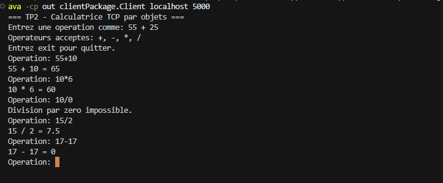
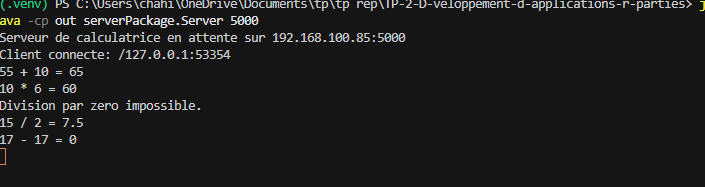

# TP2 - Echange d'objets par sockets TCP

Projet de developpement d'applications reparties (DAR), TP2 - Activite 2-2.

Cette activite met en oeuvre l'echange d'objets Java entre un client et un
serveur avec des sockets TCP et la serialisation.

## Objectifs de l'activite

- Creer une classe Java qui implemente `Serializable`.
- Envoyer du client au serveur un objet contenant deux operandes et un operateur.
- Recuperer les donnees de l'objet cote serveur et effectuer le calcul.
- Renvoyer un objet contenant le resultat au client.
- Lire et afficher le resultat cote client.

## Structure

```text
.
|-- src/
|   |-- clientPackage/
|   |   |-- CalculationResponse.java
|   |   |-- Client.java
|   |   `-- OperationRequest.java
|   |-- serverPackage/
|   `-- Server.java
|-- screenshots/
|-- README.md
`-- .gitignore
```

`OperationRequest` et `CalculationResponse` implementent `Serializable` et
constituent le protocole d'echange entre le client et le serveur. Le serveur
importe ces deux classes depuis `clientPackage` afin que les deux programmes
utilisent exactement les memes noms de classes serialisees.

```text
Socket
  -> BufferedInputStream
  -> ObjectInputStream
```

`BufferedInputStream` met en memoire tampon les donnees recues. Les flux objet
serialisent et deserialisent les instances Java.

## Fonctionnement

1. Le client analyse une expression de la forme `nombre operateur nombre`.
2. Le client construit et serialise un `OperationRequest`.
3. Le serveur deserialise la requete, recupere les trois valeurs et effectue
   le calcul.
4. Le serveur serialise un `CalculationResponse`.
5. Le client deserialise la reponse et l'affiche.

Les operateurs pris en charge sont `+`, `-`, `*` et `/`. La division par zero
est refusee par le serveur. Les expressions invalides sont refusees par le
client et ne sont pas envoyees.

## Compilation

Depuis la racine du projet :

```powershell
javac -d out (Get-ChildItem -Recurse -Filter *.java src).FullName
```

La commande equivalente, compatible avec un terminal qui accepte les
wildcards Java, est :

```powershell
javac -d out src\clientPackage\*.java src\serverPackage\Server.java
```

## Execution

### Serveur

Dans un premier terminal :

```powershell
java -cp out serverPackage.Server 5000
```

Le port par defaut est `5000`.

### Client

Dans un second terminal :

```powershell
java -cp out clientPackage.Client localhost 5000
```

L'hote par defaut est `localhost` et le port par defaut est `5000`.

Saisir ensuite, par exemple :

```text
55 + 25
20 - 7
6 * 8
15 / 4
```

Le client affiche respectivement :

```text
55 + 25 = 80
20 - 7 = 13
6 * 8 = 48
15 / 4 = 3.75
```

Saisir `exit` pour fermer proprement la session client.

## Tests d'erreur

Les saisies `25 ** 55`, `abc + 3` et `10 / 0` sont gerees sans arret du
serveur :

- les deux premieres sont refusees par le client ;
- la derniere est refusee par le serveur avec le message
  `Division par zero impossible.`

## Captures d'ecran

Les captures montrent la progression et les tests realises pendant
l'activite.

### Etape 1 - Premier test du client

Premier test du client avec l'echange d'une operation :


### Etape 2 - Premier test du serveur

Premier test du serveur apres la reception et le traitement de la requete :


### Etape 3 - Test final du client

Le client envoie une requete serialisee et affiche le resultat recu du
serveur :



### Etape 4 - Test final du serveur

Le serveur recoit l'objet, effectue le calcul et affiche le resultat :


