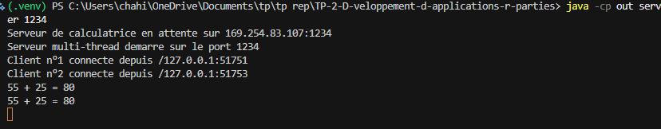
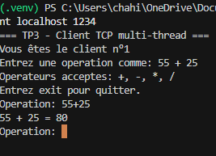
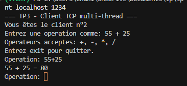
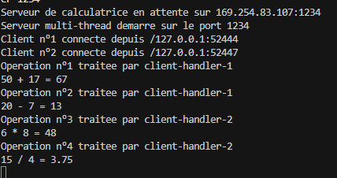
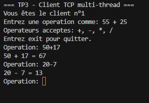
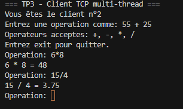

# TP3 - Serveur multi-thread TCP

Projet de developpement d'applications reparties (DAR), realise avec Java et
des sockets TCP en mode connecte.

## Objectifs

Ce projet met en oeuvre :

- un serveur TCP capable d'accepter plusieurs clients simultanement ;
- un thread dedie pour chaque client connecte ;
- l'identification de chaque client par un numero d'ordre ;
- l'echange d'objets Java serialises ;
- un service de calculatrice partage par plusieurs clients ;
- un compteur global et thread-safe des operations traitees.

## Structure du projet

```text
TP3/
|-- src/
|   |-- clientPackage/
|   |   |-- CalculationResponse.java
|   |   |-- Client.java
|   |   `-- OperationRequest.java
|   `-- serverPackage/
|       `-- Server.java
|-- screenshots/
|   |-- client1-tp3.png
|   |-- client1tp3-2.png
|   |-- client2-tp3.png
|   |-- client2tp3-2.png
|   |-- servertp3.png
|   `-- servertp3-2.png
|-- README.md
`-- .gitignore
```

## Fonctionnement

Le serveur ouvre un `ServerSocket` sur le port choisi. A chaque connexion, il :

1. attribue un numero unique au client ;
2. affiche son adresse IP et son port ;
3. cree un thread dedie ;
4. envoie au client son numero ;
5. traite les operations envoyees par ce client.

Les classes `OperationRequest` et `CalculationResponse` implementent
`Serializable`. Elles permettent d'envoyer les operations et les resultats
par `ObjectOutputStream` et `ObjectInputStream`.

Le compteur global est un `AtomicInteger`. Il est incremente une seule fois
pour chaque operation valide recue, meme lorsque plusieurs clients envoient des
operations simultanement.

## Compilation

Depuis la racine du projet :

```powershell
javac -encoding UTF-8 -d out (Get-ChildItem -Recurse -Filter *.java src).FullName
```

## Execution locale

Dans un premier terminal, lancer le serveur :

```powershell
java -cp out serverPackage.Server 1234
```

Dans plusieurs terminaux, lancer les clients :

```powershell
java -cp out clientPackage.Client localhost 1234
```

Chaque client affiche son numero de connexion, puis peut envoyer des
operations comme :

```text
55 + 25
20 - 7
6 * 8
15 / 4
```

Exemples de resultats :

```text
55 + 25 = 80
20 - 7 = 13
6 * 8 = 48
15 / 4 = 3.75
```

Pour fermer un client proprement, saisir :

```text
exit
```

## Compteur global

Le serveur affiche le compteur et le thread responsable apres chaque operation :

```text
Operation n°1 traitee par client-handler-1
55 + 25 = 80
Operation n°2 traitee par client-handler-2
20 * 3 = 60
```

Le compteur ne doit pas contenir de doublon et doit augmenter d'une unite par
operation calculee.

## Tests effectues

Les tests locaux ont ete realises avec deux clients Java connectes au meme
serveur. Les clients ont recu des numeros differents et ont execute des
operations independantes. Le serveur a correctement traite les operations
dans les threads correspondants et le compteur global est reste coherent.

Les cas suivants sont egalement geres :

- expression invalide : refusee par le client ;
- division par zero : refusee par le serveur ;
- fermeture du client avec `exit` : geree proprement.

## Test sur reseau local

Sur la machine serveur, trouver l'adresse IPv4 avec `ipconfig`, puis lancer :

```powershell
java -cp out serverPackage.Server 1234
```

Sur une autre machine du meme reseau, lancer le client en remplacant
`192.168.1.10` par l'adresse IPv4 du serveur :

```powershell
java -cp out clientPackage.Client 192.168.1.10 1234
```

Le port TCP `1234` doit etre autorise dans le pare-feu de la machine serveur.

## Captures d'ecran

### Activite 3-1 - plusieurs clients

Le serveur accepte plusieurs clients et affiche leur numero ainsi que leur
adresse :



Le premier client :



Le deuxieme client :



### Activite 3-2 - calculatrice et compteur global

Le serveur affiche les operations traitees et leur compteur global :



Le premier client de l'activite 3-2 :



Le deuxieme client de l'activite 3-2 :



## Synthese

Les activites 3-1 et 3-2 ont permis de transformer le serveur TCP initial en
un serveur multi-thread. Chaque client dispose d'une communication independante
avec un thread dedie. L'activite 3-2 ajoute le service de calculatrice par
objets Java et un compteur global protege par `AtomicInteger`, afin de compter
correctement les operations provenant de plusieurs clients simultanes.
