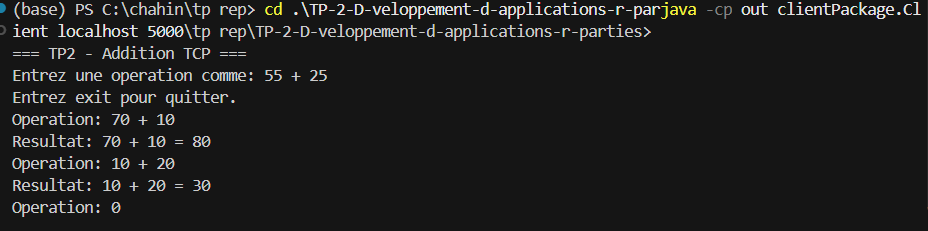
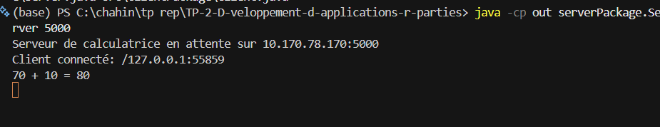

# TP2 - Echange d'operations par sockets TCP

Projet de developpement d'applications reparties (DAR) - Activite 2-1

---

## About

This project extends the one-byte communication implemented in TP1. The client sends a complete addition expression as text, such as `55 + 25`, through a TCP socket. The server calculates the result and sends it back to the client.

The current version implements addition only. Subtraction, multiplication and division will be added in later steps.

## Structure
```
.
├── src/
│   ├── clientPackage/
│   │   └── Client.java
│   └── serverPackage/
│       └── Server.java
├── screenshots/
│   └── *.png
├── README.md
└── .gitignore
```


## Objective

The objective of this activity is to exchange complete character strings between a TCP client and a TCP server instead of exchanging only one byte.

## Implementation

The client and server exchange character strings through TCP sockets using `DataInputStream` and `DataOutputStream`:

1. The client validates an expression in the form `number + number`.
2. The client sends the expression to the server.
3. The server calculates the addition.
4. The server sends the result to the client.
5. The client displays the result.

Invalid expressions such as `25 ** 55` and `abc + 3` are rejected by the client and are not sent to the server.

## Test Results

Input in the client:

```text
55 + 25
```

Expected result on the client:

```text
55 + 25 = 80
```

The server displays the operation and the calculated result:

```text
55 + 25 = 80
```

Invalid input tests:

```text
25 ** 55
abc + 3
```

Both inputs are rejected by the client.

## Screenshots

### Client test

The client sends `55 + 25` and displays the result received from the server. It also rejects invalid expressions.



### Server test

The server accepts the TCP connection, receives the expression and calculates the result.



---

## Compilation

```powershell
javac -d out src\serverPackage\Server.java src\clientPackage\Client.java
```

---

## Execution

### Server
```powershell
java -cp out serverPackage.Server [port]
```
Default port: `5000`

### Client
```powershell
This TP2 project is a Java TCP client-server calculator. It extends the one-byte communication from TP1 by allowing the client and server to exchange complete text messages.

The client sends an addition expression such as `55 + 25`. The server receives the expression, calculates the result and sends the result back to the client using `DataInputStream` and `DataOutputStream`.
```
Default host: `localhost`  
Default port: `5000`

### Cross-machine
```powershell
+-- src/
|   +-- clientPackage/
|   |   +-- Client.java
|   +-- serverPackage/
|       +-- Server.java
+-- screenshots/
|   +-- client1.png
|   +-- server1.png
+-- README.md
+-- .gitignore
1. Open a terminal in the project directory.

The `out/` directory is not part of the repository. It is created locally by the Java compilation command and can be deleted at any time.

2. Compile the project:

   ```powershell
   javac -d out src\serverPackage\Server.java src\clientPackage\Client.java
   ```

3. Start the server in the first terminal:

   ```powershell
   java -cp out serverPackage.Server 5000
   ```

4. Start the client in a second terminal:

   ```powershell
   java -cp out clientPackage.Client localhost 5000
   ```

5. Enter the following expression in the client:

   ```text
   55 + 25
   ```

6. Check that the client displays `55 + 25 = 80` and that the server displays the same calculation.

7. Enter `exit` to close the client session.

## Communication Protocol

The client and server use:

- `Socket` for the TCP connection
- `DataOutputStream.writeUTF()` to send strings
- `DataInputStream.readUTF()` to receive strings

Try-with-resources closes the sockets and streams automatically.

---

